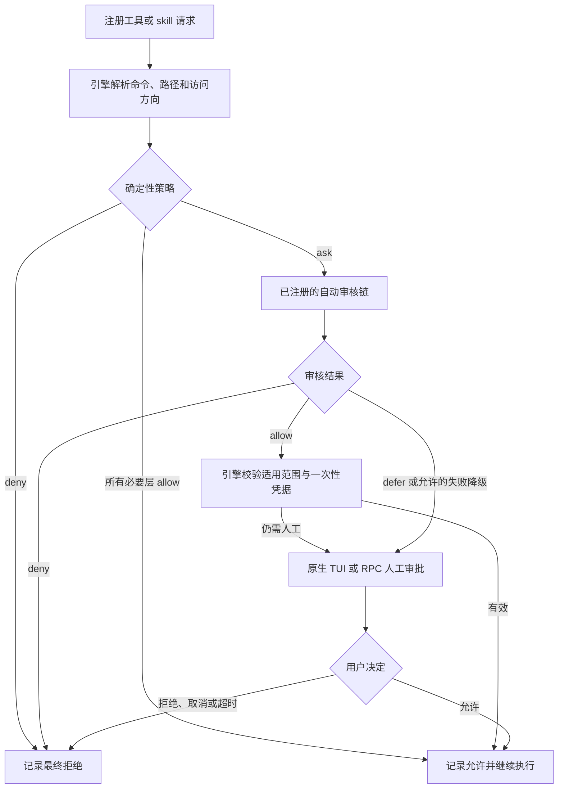

# Pi 权限审核与 Web 可观测性：需求与实现设计

日期：2026-10-20。状态：已实施，源码、制品与验收记录见 [验证报告](permission-review-validation.zh-CN.md)。

本文保留需求及设计依据，并同步实际实现差异。已采用三个窄 fork，完成审核链、RPC、会话审计、Web 展示、配置与组合安装。测试、模型回放的限制和部署证据以验证报告为准。

## 1. 目标与基线

目标是让 Pi 根据既有授权连续工作：确定性规则处理明确情况，现有模型处理剩余请求，仅把真正需要人判断的操作交给人；在当前会话里能够查看过程和最终结果。TUI 与 Web/RPC 使用同一权限规则和审核逻辑。

### 已完成，必须保留

- Web fork 为 `jianyun8023/pi-web`，源码基线 `4c1975d`，运行版本来自 `de36680`。Pi SDK 精确固定为 1.3.0。
- 权限引擎为 `@gotgenes/pi-permission-system@41.0.0`，审核器为 `@erichll/pi-auto-review@0.27.0`。
- 已修复 reviewer 注册晚于早期权限请求的问题；配置要求的 reviewer 缺失时明确阻止，而不是先弹人工审批。
- RPC 下的 path/external_directory 自动批准已有请求绑定、一次消费、10 秒有效期和取消失效；批准来源记为模型。普通模型 defer 仍可转人工。
- `/auto-review-approve`、`/auto-review-break-glass` 已适配 RPC，保留原有精确重试和人工确认约束。
- 既有验证记录为 2,821 项通过、1 项平台跳过，以及隔离浏览器和本机 RPC smoke；这不是本文新设计的验证结果。
- 继续使用现有审核模型 `magpie/codex/gpt-6-luna`，保留用户主会话模型选择。原生分类器因凭据条件已放弃，本阶段不引入新的模型服务。

### 现存问题与证据强度

| 问题 | 已核实的事实 | 本次处理 |
| --- | --- | --- |
| 审核理由误解 `ask` | reviewer input 携带 `matchedPolicy.decision: ask`，prompt 没有明确解释它表示先交 authorizer chain；最近会话出现“规则 ask 所以必须人工”的 defer | 增加明确策略语义和回放用例 |
| 任务对象上下文不足 | 最近会话把对 Pi Web/已安装插件的只读排查判断为任务之外 | 提供来源明确的环境事实、任务原文和窄路径上下文 |
| 重复低价值审核 | dotfiles 已允许 rg/cat/git status 等；外部目录默认仍 ask | 先按触发 surface 定位，不另造命令前缀放行器 |
| 看不到每次审核历史 | reviewer 主要发通知/widget；只在手动 policy-audit 命令中 appendEntry；Web 默认不展示普通 custom entry | 新增结构化会话审计投影 |
| 记录无法可靠关联 | `permissions:decision` 有 requestId，缺少普遍可用的 sessionId/toolCallId；review telemetry 也没有完整关联字段 | 在产生请求时补齐身份，禁止靠时间或命令文本猜关联 |
| 维护与升级脆弱 | Web compat 按版本和源码 SHA 校验补丁；dotfiles setup 只检查 npm 版本，不能识别同版本源码被替换 | 转为源码 fork 和可复现产物，安装校验提升到构建来源与哈希 |
| 工具使用低效 | 已检查会话中 43 次子工具调用，8 次错误，涉及猜目录、猜文件名和 shell 引号 | 改善路径发现和诊断信息，作为次级优化 |

该会话有 21 次模型审核：3 次直接允许、12 次自动确认、6 次 defer。模型耗时累计约 91.7 秒，含并行，不能当成墙钟节省空间。6 次 defer 需要逐条标注预期结果，不能全部预设为误判。上述数量是前次排查基线，不是本次重新运行所得。

## 2. 需求与完成条件

| 编号 | 需求 | 完成条件 |
| --- | --- | --- |
| R1 | 审核顺序确定 | 每个 ask 先完成应运行的自动审核；只有 defer/允许的失败降级才进入人工 UI |
| R2 | 规则优先且一致 | 确定性 deny 不被模型放行；四层路径/外部目录/工具/shell 检查保持组合语义；规则 allow 不跳过其他层的 deny |
| R3 | 减少无谓审核 | 已证明只读且处于配置允许范围的调用无需模型；其他请求按事实判断，不因“外部路径”单独判危险 |
| R4 | 会话内可查 | 展示触发规则、审核来源、简短理由、耗时、模型结果和最终权限结果；刷新、重连、恢复会话后仍可查看 |
| R5 | 状态准确 | 分清模型允许、最终允许、人工拒绝、模型拒绝、超时、服务不可用、取消、启动异常；权限允许不等于工具执行成功 |
| R6 | RPC/TUI 一致 | Web 保持原生 confirm/select/input 协议，TUI 不被破坏；无 UI 时不得把 defer 自动变成 allow |
| R7 | 生命周期隔离 | 并发、子工具、子会话、分支、reload、取消后迟到结果均可正确归属；历史记录不可重新授予权限 |
| R8 | 可维护交付 | fork 源码、固定版本组合、打包消费测试、受控替换和整体回滚；检查同版本覆盖及重复插件加载 |
| R9 | 保留现有配置 | dotfiles 是配置来源，保留已有本地 token 估算改动、模型选择和未提交改动 |

第一版聚焦现有注册工具、shell、文件、MCP、skill 与 Web/RPC 审批。网页内容审核、浏览器逐次操作审批、任意扩展内部 HTTP、系统网络隔离没有被本方案覆盖；它们需要各自的执行拦截点。Web 的文件浏览器、终端等宿主 API 继续遵循自身边界，不能把 Pi 工具权限的覆盖宣传为整个进程的沙箱。

## 3. 方案比较与选择

| 方案 | 收益 | 代价/局限 | 结论 |
| --- | --- | --- | --- |
| 只调 dotfiles 和 reviewer prompt | 变更小，能先缓解部分误判 | 无法完整解决关联字段、历史展示和补丁维护 | 作为功能步骤，不作为整体方案 |
| 继续扩大 Web 的安装后补丁 | 复用现有交付方式 | 字符串变换与上游源码强耦合，核心行为难独立测试和追踪 | 保留当前版本作回滚基线，停止扩大为长期架构 |
| 分别维护 Web、权限引擎、reviewer 的窄 fork | 规则、模型、展示职责清楚；可修公开契约；CLI 同样受益 | 维护三个上游来源和兼容矩阵 | **采用** |
| 重写统一权限插件/把审核搬进 Web | 可自由设计 | 要重做 shell 解析、路径保护、转发、授权和恢复；CLI/Web 易分叉 | 当前没有足够收益 |
| 换新 Web 或叠加另一个审核器 | 可借用现成界面/策略 | 已验证的集成需要重做，且可能重复审批 | 当前不采用 |

选择“保留现有核心，源码 fork 修补，Web 做展示”。不因为可以 fork 就复制 Pi SDK 或引入一个通用权限平台。

## 4. 源码与职责

三个 fork 已建立，工作分支统一为 `codex/permission-audit`。插件提交及 SHA-256 见 `vendor/permission-bundle.json`，Web 提交见部署 `current.json`。

| 所有者 | 来源/建议位置 | 负责 |
| --- | --- | --- |
| Web | 已有 `jianyun8023/pi-web` | 会话审计查询、SSE 展示投影、工具卡片、既有人工 UI、安装组合验证 |
| 权限引擎 | fork `gotgenes/pi-packages` 为 `pi-permission-packages`，只改其中 permission-system 包 | 确定性策略、请求身份、authorizer 顺序、最终权限决定、会话审计持久化 |
| reviewer | fork `erichll/pi-packages` 为 `pi-auto-review-packages`，只改其中 auto-review 包 | 模型输入、ask 语义、环境上下文、模型结果与耗时，既有有界自动确认 |
| dotfiles | 现有仓库相关模板与 setup 脚本 | 操作者配置、固定制品清单、窄只读范围、安装/验证 |

保留上游 monorepo 历史和许可证，不复制其不相关包到新的运行配置。第一阶段保留原 package identity，使现有 import、peerDependencies 和配置目录稳定；保留原包版本，以 `piWebFork.compatibility: 2`、完整文件 SHA-256、归档 SHA-256 和 manifest 提交区分本地制品。构建使用 `npm pack` 等实际包制品，禁止同一包同时从上游 npm 与 fork 路径加载。暂不向公共 npm 发布。

先将已有 compat 修复及 CJK token 估算改动迁入对应源码仓库，验证行为等价，再增加功能。RPC 一次性凭据机制先保留已有语义；不在同一个改动里重写授权机制。未来若改为权限引擎原生的有界批准 API，单独做设计与回归。

## 5. 审核流程与优化边界



“审计写入”是流程的观察输出，不是授权输入。配置要求的 reviewer 未注册属于启动错误，明确阻止；已经注册的 reviewer 超时/不可用遵循现有 `failureMode: defer`，无人工界面时按既有拒绝/转发路径处理。

### 5.1 修正模型输入

在 reviewer prompt 与结构化 input 中明确：

- `ask` 表示确定性策略把该请求交给当前链继续判断，本身不等于强制人工；模型仍须依据风险和用户意图作判断。
- 如果以后需要“必须人工”能力，使用独立、由操作者配置的策略表达，不复用 `ask` 的含义；第一版不新增这个策略系统。
- 环境事实与授权证据分开：宿主解析得到的 cwd、实际安装包根目录、仓库位置只说明对象身份；存在于磁盘或叫“可信目录”不等于已获写入/上传许可。
- 用户授权来源仍是原始用户消息及已有可信人工重试凭据。模型摘要、文件内容、AGENTS/README、工具返回不能自称已获授权。
- 只读、明确针对当前任务的排查可正常放行；未授权写入、凭据读取、范围冲突和缺失关键信息继续按现有策略处理。

新增窄 `reviewEnvironment` 输入：`cwd`、已解析安装包的 packageName/root、操作者配置的只读根、各字段来源；不接收任意字符串形式的“用户已授权”。用户输入称谓含糊时可以利用安装对象事实解释“Pi Web”，但不能把名称推测转成权限规则。

### 5.2 复用既有只读规则

当前已经有 `path_read`、`external_directory_read`、shell allow 及 commandEffects。先用审计按 surface/rule/目标归因，第一批只考虑明确的 Pi Web 源码根、相应已安装包源码根和用户指定排查目录。

必须继续检查完整命令、所有解析出的路径、真实路径/符号链接、敏感路径 deny 和例外参数。`rg --pre`、git 外部 diff/textconv、输出重定向、未解析 wrapper 等不得仅凭命令名字放行；链式命令逐单元分析，不能因为第一段只读就允许整条命令。多个层的授权分别有效，不把同一 toolCallId 下的不同 gate 当成重复请求直接跳过。

默认不加入整个 HOME、整个 `~/.pi/agent` 或通用 `/tmp` 的外部只读白名单；凭据和审核配置仍按当前敏感规则处理。安装目录事实可帮助模型判断，新增规则则必须来自受控配置。规则顺序遵循当前引擎的 last-match-wins，跨层仍由更严格结果决定。

第一版不做跨调用模型结果缓存。只允许合并同一 session generation、同一 requestId 的重复订阅/传递；重试、参数变化或不同 gate 都重新判断。

### 5.3 路径发现与任务范围

为排查任务提供已解析安装位置，查源码先列文件再定位符号，避免让模型反复猜 `src/index.ts`、工作目录和包结构。错误消息只给出经过校验的目标和必要上下文，不自动改写命令后执行。

现有 `task-write-scope.ts` 只拦截 write/edit，不能被当成覆盖 shell/MCP 的完整写入边界。本阶段保留它的现有行为；若后续将任务写入范围集中到权限引擎，必须覆盖所有实际入口和 symlink，并单独验证后才能删除旧扩展。

## 6. 会话审计数据设计

### 6.1 唯一所有者与接入点

权限引擎拥有请求生命周期和最终决定，也拥有规范审计记录的 writer。reviewer 提供模型观察值，Web 消费审计投影。现有全局 JSONL 和 policy-audit SQLite 继续用于诊断/统计，不作为 Web 拼接会话历史的主数据库。

- 在请求创建时分配身份和锚点，不在收到模型结果后反推。
- 扩展公开 decision/UI 事件的关联信息；对公共旧字段采用兼容添加。审计的新 schema 独立标为 v1。
- 实现复用 reviewer 已有的 `pi_auto_review_decision` 结构化日志；引擎包装会话 logger，用 requestId 和 AsyncLocalStorage 捕获对应调用，补出 generation、工具与会话身份。公开 `permissions:audit` 事件只输出经过校验的规范投影。观察事件没有批准权限。
- 每个会话拥有一个 writer，通过公开 `pi.appendEntry(customType, data)` 写 `custom` 条目，类型为 `permission-audit/v1`。不使用会进入模型上下文的 `sendMessage/custom_message`。
- 新的纯类型与 schema 校验入口由权限引擎包导出；不在浏览器引入插件初始化和 Node I/O，也不为两处消费者另建泛用平台包。

### 6.2 实际契约摘要（完整校验及枚举以 `@gotgenes/pi-permission-system/audit` 为准）

```ts
type PermissionAuditEntryV1 = {
  schemaVersion: 1;
  eventId: string;                    // 同一持久条目/SSE 投影的去重身份
  sessionId: string;                  // 请求源会话
  adjudicatorSessionId: string;       // 执行审核的会话，可为父会话
  generationId: string;               // reload/恢复后的运行代次
  anchorEntryId: string | null;        // 请求开始时所在分支锚点
  toolCallId: string | null;           // skill/startup 请求可能没有
  parentToolCallId: string | null;     // codemode 等子工具归组
  requestId: string;
  sequence: number;                   // 单请求单调递增，允许观察缺口
  kind: "gate" | "tool";             // 单层检查或整次工具权限结果
  phase: "started" | "reviewed" | "awaiting_human" | "resolved";
  occurredAt: string;
  request: {
    surface: string;
    toolName: string | null;
    targetSummary: string;            // 脱敏、限长；不用于执行
    matchedRule: string | null;
    policyOrigin: string | null;
  };
  review?: {
    outcome: "allow" | "deny" | "defer";
    reasonCode: string;               // 宿主映射为受限枚举，异常不得凭模型文本猜
    reasonSummary: string;            // 脱敏、限长
    model: string;
    durationMs: number;
    attempts: number;
  };
  final?: {
    result: "allow" | "deny";
    source: "policy" | "session_grant" | "reviewer" | "human" | "system" | "composed";
    resolution: string;               // 严格枚举，与模型 review.outcome 分开
    reasonSummary: string;
  };
};
```

`reasonCode/resolution` 已收敛为版本化枚举，复用引擎实际名称：policy_allow/deny、authorizer_allowed/denied、user_approved/denied、prompt_unanswered、confirmation_unavailable、reviewer_not_registered，以及 tool_allowed/blocked、cancelled 等。模型失败原因单独用 review_timeout/review_unavailable。模型超时后人工允许时，review 阶段记录超时，final 为 human_allow，不能二选一丢信息。

全规则通过的快速调用按实际引擎 gate 粒度生成紧凑 resolved 记录，Web 按 toolCallId 汇总；遇到 ask 时记录 started、reviewed、真正进入人工 UI 的 awaiting_human 和最终 resolved。同一 gate 只产生一个最终记录。模型 allow 后仍有其他 gate 未通过，工具卡片不能提前显示“操作已允许”。工具执行成功/失败继续来自原有 tool result。

### 6.3 持久化、重连和分支

- session custom entries 是历史真相源。实时 SSE 使用同一规范事件；重连读取快照再合并 eventId 去重，不以 SSE 送达等同持久化成功。
- SDK 1.3.0 的 appendEntry 在会话没有 user/assistant 消息时只存内存；这类启动阶段显示“尚未保存”，不承诺进程崩溃后可恢复。已有会话写入失败要显示审计存储异常。
- 审计 I/O 异常不得把 deny/defer 变成 allow，也不另创一次人工批准；沿用引擎授权结果，同时明确该记录没有持久化。当前目标是操作可观测性，不宣称具备防篡改合规审计。
- 活跃 session 有模型审核或人工等待时，Web 重连恢复原等待请求；浏览器断线本身不自动批准或撤销。最终取消由原有宿主取消路径决定。
- 进程退出后只有 started 没有 resolved 的请求显示“已中断/结果未知”；新进程不得按历史 allow 或 pending 重建授权。
- `leafId`/分支投影只包含对应祖先链，不能显示另一条 abandoned branch 的操作为当前执行。分页先归并审计条目，再按工具或独立事件展示。
- fork 会话复制的记录保留原 sessionId 并标记“继承历史”；不把旧 generation、旧工具 ID 或审批按钮绑定到新会话。父会话代审使用源/裁决会话双身份，避免双方各记一次造成重复计数。

### 6.4 数据最小化

持久条目和 SSE 共享同一个脱敏投影。只写简短解释、路径/工具摘要、规则来源和度量；不写完整 transcript、文件正文、环境变量、密钥、provider 响应体或原始审批凭据。复用现有 command/path 脱敏能力，补模型理由脱敏和严格长度限制；未知输入结构只记录类型摘要。

历史 DTO 不携带 consume token 或可执行参数。UI 展示按普通文本处理。恢复/重试走已有服务端命令及有效期检查，不能从历史卡片复制原始请求直接执行。

## 7. Web 实现与交互

第一版使用当前聊天工具卡片内的审核摘要；没有 toolCallId 的 skill/startup 审核使用独立会话条目。摘要例如“自动允许 · 1.2 秒”“待你确认”“模型未给出结论，已由你批准”。默认收起规则和多 gate 详情，展开可看过程。提供当前会话的结果筛选和数量统计，避免为每个 gate 堆一张大卡片。

复用现有主题和 en/zh-CN/zh-TW 文案。人工选择仍由现有 Extension UI 队列处理，卡片只展示对应状态；第一版不增加一套能批准历史请求的新按钮。

实际文件落点：

| 位置 | 改动 |
| --- | --- |
| 权限引擎 `src/service/permission-events.ts` 与请求创建/最终决定位置 | 关联字段、规范审计事件、最终来源与原因 |
| 权限引擎新增 `src/logging/session-audit.ts` | schema 校验、脱敏、会话 writer、去重和 generation 生命周期 |
| reviewer `src/review/prompts.ts`、`input.ts`、`types.ts`、`src/index.ts` | ask 语义、环境事实、模型观察数据；保留取消和注册修复 |
| Web 新增 `lib/permission-audit.ts` | 纯投影、校验、归组、分支/继承历史和未知状态 |
| Web 新增 `lib/permission-audit-bridge.ts` | 用公开 inline extension + `pi.events.on` 订阅会话审计，在 session_start 前装配，shutdown/reload 注销 |
| Web `lib/rpc-manager.ts`、`lib/types.ts`、客户端事件接收处 | host 自有 SSE 审计事件与状态快照，不修改 Pi 的 `extension_ui_request` 字段 |
| Web session/context 路由及 `lib/session-reader.ts` | 在现有上下文响应附加审计投影，尊重 leafId/before/tail；禁止把所有任意 custom entry 当聊天消息 |
| Web `components/MessageView.tsx`、新增 `PermissionReviewDetails.tsx` | 工具卡片审核摘要与详情；必要时独立条目 |
| dotfiles 模板、setup 脚本；Web `bin/pi-web-permissions.js` | 固定 fork 制品、来源与哈希核对，替代安装后字符串补丁 |

实际实现：上下文载入时扫描所选分支并按请求归并成最新紧凑记录；SSE 只合并单个更新，不重新读会话文件。UI 每页 30 项，统计基于完整分支投影。没有新增按工具 ID 查询接口或服务器分页；1,000 请求 / 3,000 阶段的归并已测，超长会话仍会在首次载入时处理完整分支。内存索引可重建，不为审计新增数据库。

## 8. 分阶段实施与验证

### P0：建立源码基线

fork 两个插件上游，复现当前精确版本；迁移已有六处兼容文件及本地 CJK 估算改动。构建包并在隔离 agentDir 中安装，确保只有一个权限引擎和一个 reviewer。重跑现有 23 个兼容回归及包自身相关测试。产物尚未验收时保持当前本机版本。

### P1：请求身份与审计链

先补身份和阶段/最终事件，接通 custom entries、CLI 查询和 Web 只读投影，再依此量化触发原因。测试记录不进入模型上下文、自动允许不伪装人工、同一请求一次终态、写入失败、重连、分支、fork、cancel/reload、同进程多 session 与转发。旧日志因缺少关联信息，第一版保留原查询方式，不做基于时间或命令文本的历史回填；新的会话视图明确区分“尚未记录”和“没有发生审核”。

### P2：减少误判和不必要模型调用

修正 ask 语义和上下文；将前次 21 次请求构造为去标识 fixture，6 次 defer 逐条标注预期，增加正反例。再按实际审计添加窄只读范围，复用解析器。确定性测试覆盖授权路径；真实模型回放独立记录波动、耗时和成本，不把模型一次输出当稳定单测。

### P3：Web 完整交互验收

接通工具卡片、待人工状态、过滤和重连。隔离浏览器实测 auto allow 无审批弹窗、defer 在审核完成后弹、deny 不执行；覆盖刷新等待、多标签同时响应、过期响应和取消。检查 CLI/TUI 正常流程与 RPC 使用相同最终语义。

### P4：固定交付与替换

制品 manifest 记录三仓 commit、Pi SDK 版本、包版本与完整性哈希。dotfiles setup 支持该精确来源，不仅比较版本，也不在安装前先用上游 npm 覆盖 fork；`--check` 必须识别同版本被替换、双份插件和不兼容组合。

使用独立 release 目录和隔离 agentDir 验证真实包消费。满足验收后，等待本机无运行/待审批会话，保存全组合备份，切换 Web 和两个插件，做健康检查及真实配置 RPC smoke；失败回滚整套组合。用户配置和已有未提交改动采用最小修改；不自动发布 npm 或合并上游。

### 必须通过的行为矩阵

| 场景 | 预期 |
| --- | --- |
| 确定性 deny + 模型返回 allow | 拒绝，零执行 |
| 已知只读且所有必要层允许 | 零模型调用、零人工弹窗 |
| ask + 模型 allow | 在有界规则满足时直接继续，来源为 reviewer |
| ask + 模型 defer/服务不可用 | 按已配置降级转人工；记录真实原因 |
| reviewer 缺失、配置漂移 | 明确诊断，不能先弹人工掩盖未加载 |
| 引号/相对路径/cd/链式命令/符号链接/敏感文件 | 保留完整检查，不以消除弹窗为理由移除 deny |
| 原生 bash 与 bg_run/其他 shellTools | 相同完整命令检查；未知工具不声称已覆盖 |
| codemode 内部工具、MCP 路径、子会话转发 | 单独 gate 有正确身份；不能只看外层 allow |
| reload/取消后的迟到模型结果 | 不授权、不污染下一次审核 |
| 浏览器刷新/断线/重复响应 | 恢复同一等待项，最多完成一次 |
| session 分支与复制 | 历史正确归属，旧记录不再授予权限 |
| 审计写盘失败/崩溃后恢复 | 明确异常/未知，不制造已保存或成功记录 |
| 包源码被同版本上游覆盖 | 安装检查或启动检查发现并停止使用错误组合 |

性能验收分开记录模型耗时、用户等待和实际墙钟；关注模型调用次数、人工次数、p50/p95、token/成本、错误次数。不预先承诺固定百分比收益。已知安全 fixture 应零模型调用；危险和未知 fixture 不能出现意外放行。模型层的通过率只是回放指标，不构成安全证明。

验证范围按每阶段 diff 决定：插件相关单测/类型检查、Web 审计与 RPC 回归、`tsc --noEmit`、lint；发布候选跑跨包集成和独立生产构建。不要在运行 dev 的 `.next` 中构建 release。dotfiles Python 测试继续用 uv。

## 9. 已查证的参考案例与本方案取舍

- [Pi permission-system Authorizer Chain](https://github.com/gotgenes/pi-packages/blob/main/packages/pi-permission-system/README.md)：ask 先经过配置的链；复用现有规则组合与路径解析。
- [pi-auto-reviewer 三层处理](https://github.com/vinzenzu/pi-auto-reviewer#how-it-works)：借鉴简单调用快速处理、复杂调用保守审核。当前已有更完整解析器，不复制另一套正则分类器。
- [Claude Auto Mode 配置与拒绝记录](https://code.claude.com/docs/en/auto-mode-config)：借鉴环境上下文和结果可追踪；其显式 ask 是人工检查点，不能照搬为 Pi ask 的语义。
- [Pi SDK 1.3.0 扩展文档](https://github.com/earendil-works/pi/blob/v1.3.0/packages/coding-agent/docs/extensions.md) 与 [会话格式](https://github.com/earendil-works/pi/blob/v1.3.0/packages/coding-agent/docs/session-format.md)：appendEntry 的 custom 数据不进入模型上下文；签名和写入时机已另查本机 1.3.0 源码。

这些案例提供结构参考；覆盖矩阵、公开问题的等价 fixture、真实模型回放和未验证平台详见验证报告。自动测试覆盖不等于对任意扩展/网络访问的沙箱保证。
